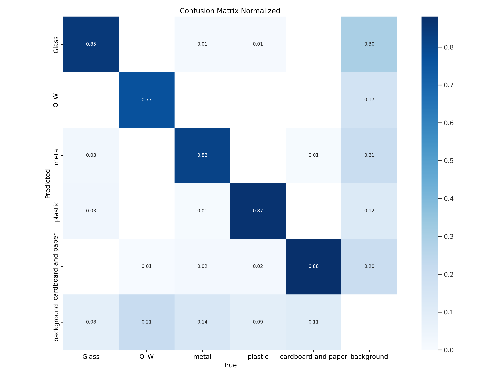

# AI Waste Sorting System

> Camera → YOLOv8 detection → live dashboard → servo sorter. Five waste types sorted automatically at **87.1% mAP@50**.



## Highlights

| Metric | Result |
|---|---|
| mAP@50 (5 classes) | **87.1%** |
| mAP@50–95 | 74.3% |
| Precision / recall | 86.8% / 78.3% |
| Best class (plastic) | **91.3%** mAP@50 |
| Inference | ~4.6 ms per image (Tesla T4) |

- Classes: glass, organic waste, metal, plastic, cardboard and paper
- Streamlit dashboard with live detections, counts and charts; manual and automatic modes
- Arduino drives three servos over a serial link (PySerial)

## Repository structure

```
app/main.py                          Streamlit dashboard, detection and serial control
firmware/servo_sorter/servo_sorter.ino  Arduino servo state machines (one per bin)
results/                             Training curves, confusion matrix and validation results
```

## Run

```bash
pip install -r requirements.txt
streamlit run app/main.py
```

Upload your YOLOv8 weights (`.pt`) in the app, pick the camera and the Arduino port, then start detection.
Training data and weights are not included.

## Licence

Copyright © 2025 Muhammad Asad Nadeem. All rights reserved.
The code is shared for viewing as part of my engineering portfolio. Please contact me before reusing it.
